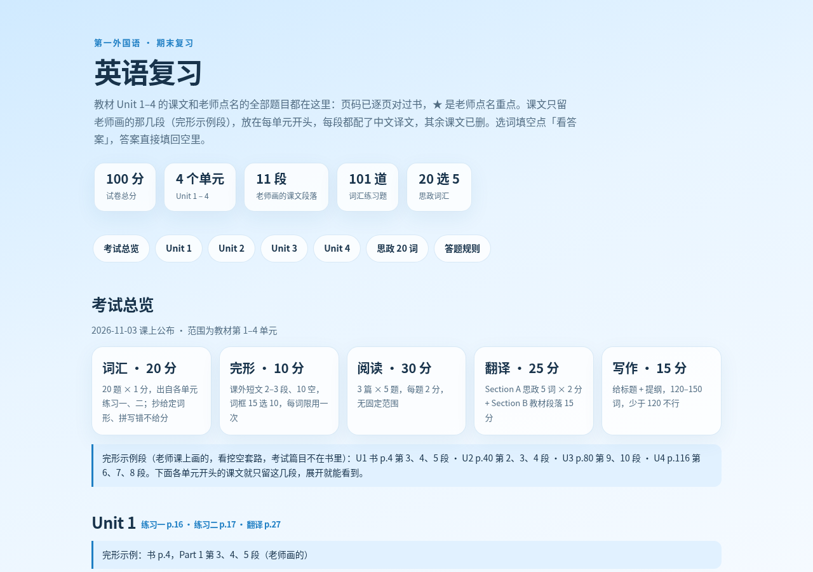

# 英语复习 · Unit 1–4 期末

一个可直接用浏览器打开 `index.html` 的单文件英语期末复习网页，无需安装依赖。内容包括教材 Unit 1–4 的 101 道词汇、词组和搭配练习，老师画出的完形示例课文节选及逐段中文译文、四单元翻译参考、思政中译英 20 词，以及考试总览和答题纸规则。练习支持逐题或整节显示、收起答案，课文和参考译文可折叠查看。

## 改版说明 · 天蓝 Celeste 风

页面改用天蓝渐变背景，以 `#1f7fc4` 为主色，搭配略透明的白色卡片。统一的系统字体、轻柔阴影和更疏朗的间距，让长篇中英材料更容易阅读。导航、按钮和重点标记沿用原有结构，并补充清晰的键盘焦点样式。全部题目、答案、课文、译文和内嵌图片数据保持原样。

当前环境中 Chromium 启动失败，尚未生成上述截图；失败原因及重试命令见 [FINDINGS.md](FINDINGS.md)。
